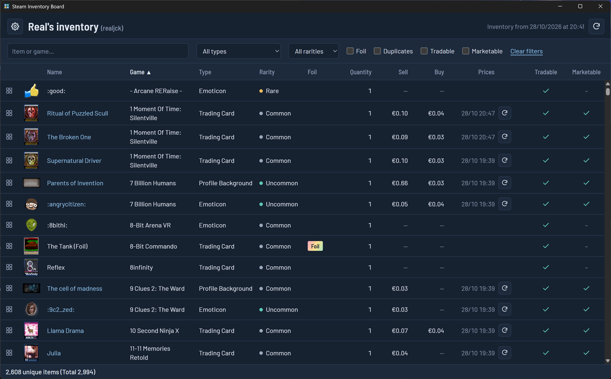

# Steam Inventory Board

Windows desktop app (Tauri) that shows a public Steam community inventory (trading cards, backgrounds, emoticons, boosters, gems) in one sortable, filterable table, with duplicates grouped and market prices fetched on demand. Read-only: no Steam login, no selling, no trading.



## Features

- **One row per distinct item** (grouped by `market_hash_name`, quantities summed): image, name, game, type, rarity, foil, quantity, tradable, marketable, lowest sell price, highest buy order.
- **Filters**: text search on item and game names (case and accent insensitive), type, rarity, foil, duplicates (quantity ≥ 2), tradable, marketable.
- **Sorting** on every column; items without a price always sort last.
- **Footer**: unique items and total quantity, e.g. "2,608 unique items (Total 2,994)", or "61 of 2,608 unique items (Total 447)" when filters hide some.
- **Links**, opened in the default browser:
  - the item name → its Steam Community Market page (marketable items only);
  - the 2×2 tiles icon → your badge page for the item's game, which lists the cards you have collected (none for gems and other Steam items).
- **Title**: the owner's persona name and custom URL name, e.g. "Real's inventory (realjck)", read from the public profile.
- **Prices on demand only**: nothing is fetched at startup or in the background. Each row has a "Get prices" button, then shows the prices, their date and a refresh button. Cached prices show at once on the next start; an old price is recognisable by its date.
- **Inventory refresh** button, with the date of the last fetch.
- English interface; numbers, prices and dates in the `en-GB` format (€0.13, 2,608, 28/10 14:32).

## Use

Run `steam-inventory-board.exe` (or install it with `steam-inventory-board_<version>_x64-setup.exe`). At first launch, enter your 17-digit **SteamID64** in the settings screen (gear icon, top left, to change it later). The inventory must be **public**.

A new SteamID is kept only if its inventory loads; a private or unknown inventory shows how to fix it and keeps the previous account.

## How it works

### Steam data

These Steam endpoints are undocumented; they were checked with the recon script (see below).

| Data | Request | Notes |
|---|---|---|
| Inventory | `GET steamcommunity.com/inventory/{steamid}/753/6?l=english&count=2000` | Community items (app 753, context 6). Paged with `start_assetid` while `more_items` is set; 2,000 is the largest page. Types, rarities, foil and game come from the item tags. |
| Prices | `GET steamcommunity.com/market/orderbook?q=Load&qp=[753,"{market_hash_name}"]` with `x-valve-request-type: queryAction` | The call Steam's own market pages make. One request gives the lowest sell listing and highest buy order, in hundredths of the currency Steam picks from your location. |
| Owner's names | `GET steamcommunity.com/profiles/{steamid}?xml=1` | Persona name and custom URL, read on each inventory refresh. |

Older routes no longer fit: listing pages no longer expose the `item_nameid` that `itemordershistogram` needs, `search/render` returns 10 results per page in USD only, and `priceoverview` only adds the median price and volume.

### Market rate limit

Steam's market limit is unknown and deliberately not probed. Every price request goes through one queue: one request at a time, at least 3 s apart, with a 30 s, 60 s, then 120 s back-off on HTTP 429 before giving up. Clicking twenty rows queues twenty requests ("Queued", then "Loading"); clicking the same row twice sends one.

### Cache

A SQLite database in `%APPDATA%\com.realjck.steaminventoryboard\` holds the inventory (with the SteamID it belongs to), the prices with their currency and date (kept across inventory refreshes, no expiry), the owner's names and the SteamID setting. The table shows from the cache at startup; the inventory is fetched automatically only when the cache does not hold it for the current SteamID (first launch, account change, interrupted save).

### Privacy and security

- Steam requests are made by the app's Rust side (`tauri-plugin-http`), allowed only to the three URLs above, with no cookie jar and no `Origin` header (the order book answers 401 to the app's origin).
- Links may only open `steamcommunity.com` pages; images only load from Steam's CDN.
- No Steam credential or cookie is asked for or stored.

### Out of scope

Selling, trading or offers; several accounts at once; game inventories (CS2, TF2…); bulk price fetching; badge and set progress (a possible next step).

## Develop

Requires Node 22.18+ (runs TypeScript natively) and the Rust toolchain.

```sh
npm install
npm run tauri dev     # app window with hot reload
npm run tauri build   # src-tauri/target/release/steam-inventory-board.exe + NSIS installer
```

- `npm test`: unit tests (`node:test`; the store runs against an in-memory SQLite)
- `npm run typecheck`: TypeScript check
- `npm run recon -- <SteamID64>`: calls each Steam endpoint once and saves the raw responses to `samples/`, to re-check them if Steam changes

| Folder | Contents |
|---|---|
| `src/core` | Pure logic: inventory grouping, order book and currencies, queue, filters, sorting, formats, messages |
| `src/data` | SQLite store behind a small `SqlClient` interface, and its schema |
| `src/app` | App services (inventory, prices, SteamID) and the Tauri plugin wiring |
| `src/web` | Interface: table and settings, Vite + TypeScript without a framework |
| `src-tauri` | Rust shell: plugins, database migration, permissions, CSP |
| `docs/superpowers` | Design and implementation plan of the desktop app (French) |
